# BrainTumorLab — AI-powered 3D brain tumor analysis

**The idea:** give the app a brain MRI, and the AI finds the tumor, measures it, shows it in 3D and tells
whether it is **low grade (LGG)** or **high grade (HGG)**.

> Mini project. It is **not** a medical tool and must not be used for diagnosis.

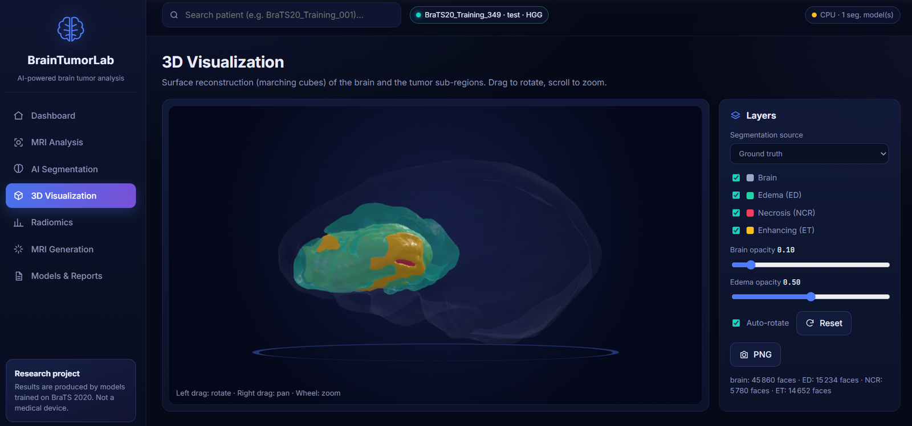

## Fields


| Field | Where in the project |
|---|---|
| **Computer Vision** | the AI "looks" at MRI in 3D and finds the tumor (segmentation) |
| **Deep Learning** | 3D U-Net (segmentation) and 3D CNN (grade LGG / HGG) neural networks |
| **Generative AI** | Med-DDPM diffusion model that creates MRI images and "what-if" scenarios |
| **Machine Learning** | patient clustering (K-Means), tumor measurements (radiomics) |
| **Medical Imaging** | BraTS 2020 brain MRI, NIfTI and DICOM formats |
| **Data Analysis** | comparison of the 4 MRI types, statistics, charts |
| **Web Development** | full interface: FastAPI, HTML / CSS / JavaScript, three.js 3D view |

## Why this project
For a patient with a brain tumor (glioma), a doctor has to draw the tumor by hand on hundreds of MRI
images. It takes time and varies from one doctor to another. This project shows how AI can:
- **find and outline the tumor automatically**, in 3D;
- **measure it** (volume, shape, position);
- **estimate its grade**;
- **create a missing MRI image**.

## The data
- **BraTS 2020**: 368 glioma patients, a public dataset of brain MRI.
- For each patient, **4 MRI types**: FLAIR, T1, T1ce (with contrast agent) and T2.
  Each one shows the tumor in a different way.
- For each patient, an **expert segmentation**. It is the "right answer": it is used to train the AI and
  to check its results. Once trained, the AI no longer needs it.
- The tumor is split into **3 zones**:

| Zone | What it is |
|---|---|
| 🔴 Necrosis (NCR) | the dead core of the tumor |
| 🟢 Edema (ED) | the swelling around the tumor |
| 🟡 Enhancing tumor (ET) | the active part that takes up the contrast agent |

## What the app does
1. **Import** an MRI (NIfTI or DICOM), even without segmentation.
2. **Segmentation**: the AI colours the 3 tumor zones, slice by slice, in 3D.
3. **Measurements**: volume of each zone, position in the brain, shape.
4. **Grade**: the AI estimates whether the tumor is LGG or HGG.
5. **3D view** of the brain and the tumor.
6. **Printable report** (PDF).

One button does everything: **Run full AI analysis**.

## Key results
Measured on **55 test patients** that the AI never saw during training.

| Task | Result | In plain words |
|---|---|---|
| Whole-tumor segmentation | **Dice 0.88** | the AI's outline matches the experts' at 88 % |
| Tumor-core segmentation | **Dice 0.83** | good |
| Enhancing-tumor segmentation | **Dice 0.71** | harder: it is a thin ring |
| Grade LGG / HGG | **AUC 0.89** | the AI separates the two grades well |
| T2 MRI generation | to improve | the model needs more training |

Dice goes from 0 (nothing in common) to 1 (identical). The best BraTS challenge teams reach about
0.89 / 0.85 / 0.79.

## Techniques used
| Technique | Purpose | Simple explanation |
|---|---|---|
| **Preprocessing** | prepare the images | every MRI gets the same size (160 × 192 × 160) and the same intensity scale, so the AI can compare them |
| **3D U-Net** (MONAI) | segmentation | a "U"-shaped neural network: it shrinks the image to understand the context, then enlarges it again to draw the tumor voxel by voxel. It works directly in 3D |
| **3D CNN** | grade LGG / HGG | a neural network that looks at the whole volume and gives a "high grade" probability |
| **Radiomics** | describe the tumor | numbers computed on the tumor: volume, surface, roundness (sphericity), length, texture |
| **Med-DDPM** (diffusion model) | create an MRI | the AI starts from random noise and turns it step by step into a T2 image, guided by the patient's other information |
| **"What-if" scenarios** | simulations | the diffusion model changes only the tumor area to simulate surgery, growth or treatment response |
| **Marching cubes** + three.js | 3D view | turns the segmentation into a 3D surface you can rotate in the browser |
| **Data analysis** | understand the MRI | comparison of the 4 MRI types: **FLAIR** shows the whole tumor best, **T1ce** the active part |

## The interface
The web app has **7 pages**. All screenshots below come from the real app running in Google Colab
with the trained models (test patient BraTS20_Training_349 unless stated otherwise).

### 1. Dashboard
Overview of the dataset (368 patients, 292 HGG / 76 LGG, median tumor volume 90.7 mL), the latest
analyses and the best segmentation score.
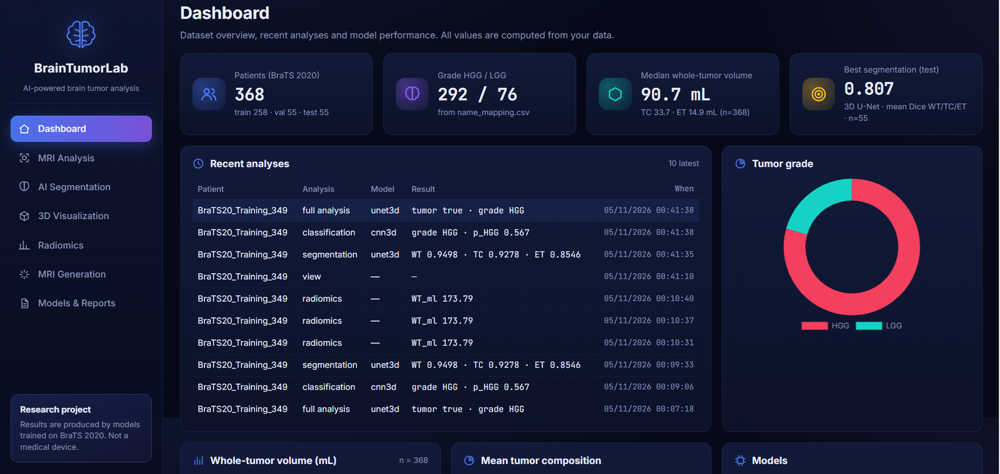

Tumor-volume distribution, mean tumor composition and the models loaded in the app.
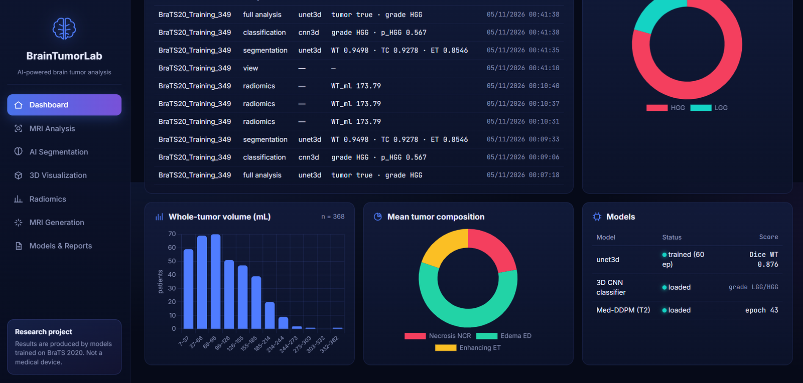

### 2. MRI Analysis
3-plane MRI viewer (axial, coronal, sagittal) for the 4 MRI types, with the tumor overlay.
**Run full AI analysis** segments the tumor, measures it, locates it and predicts the grade in one click.
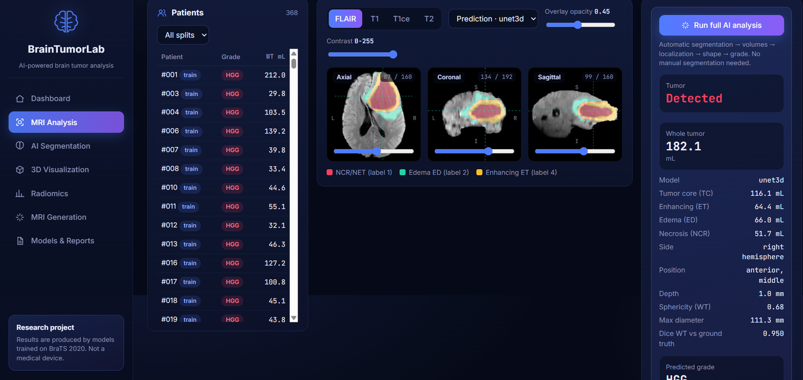

| Grade prediction (LGG / HGG + radiological profile) |
|---|
| 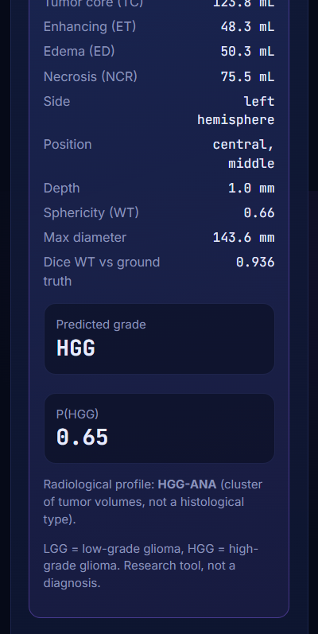 |

### 3. AI Segmentation
Original MRI, experts' answer (ground truth), AI prediction and error map, with the scores of each tumor zone.
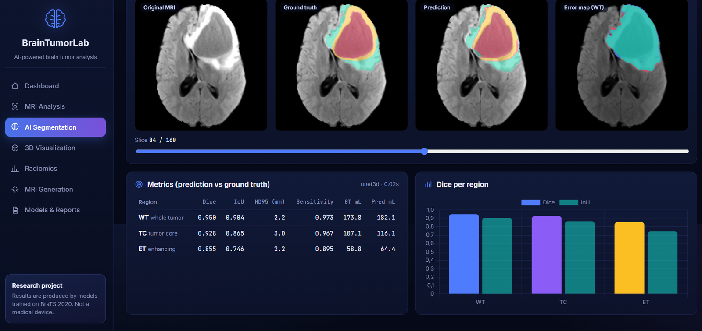

### 4. 3D Visualization
Brain and tumor zones in 3D (edema in green, active part in yellow, necrosis in red). Rotate and zoom with the mouse.


### 5. Radiomics
Shape measurements of each tumor zone (volume, surface, sphericity, diameter, axes)...
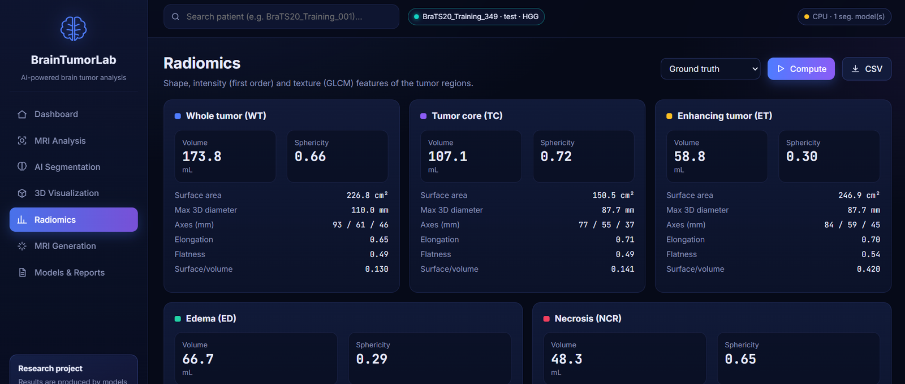

...and intensity and texture: tumor compared with healthy brain on each MRI type.
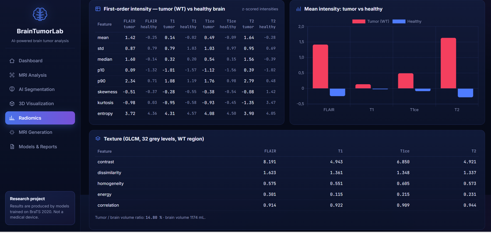

### 6. MRI Generation
Med-DDPM creates a T2 image from noise, guided by the other MRI and the tumor mask, and compares it with the real T2.
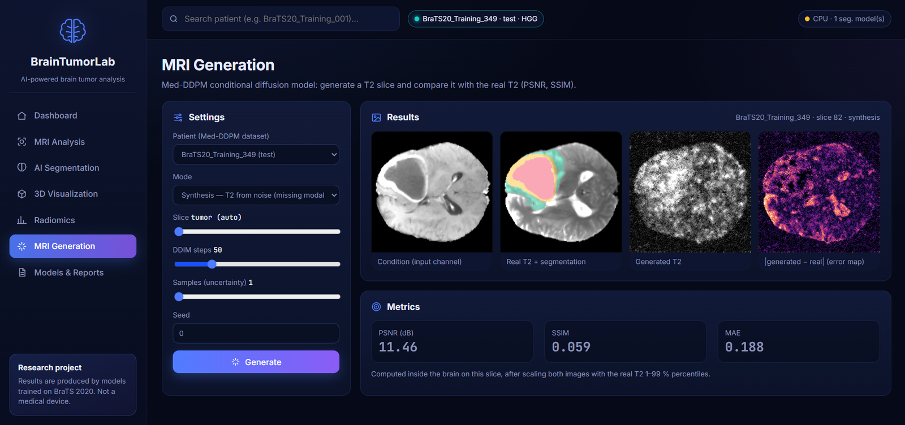

### 7. Models & Reports
Test-set results of the models (Dice, HD95, training curve, score per patient)...
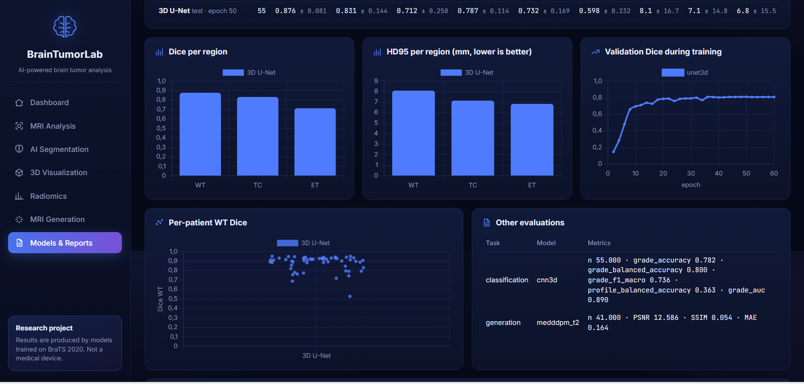

...and a printable patient report (PDF).
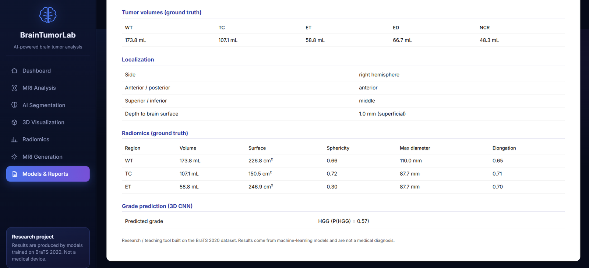

## Results in pictures
### Data analysis — the 4 MRI types
| MRI types with the tumor zones | Tumor vs healthy brain intensity |
|---|---|
| 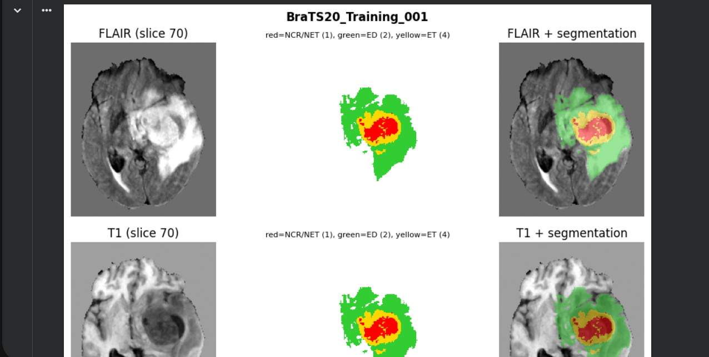 | 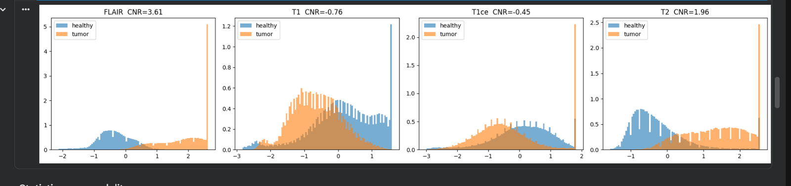 |

| Which MRI types find the tumor best (15 combinations) | Patients grouped by tumor appearance (K-Means) |
|---|---|
| 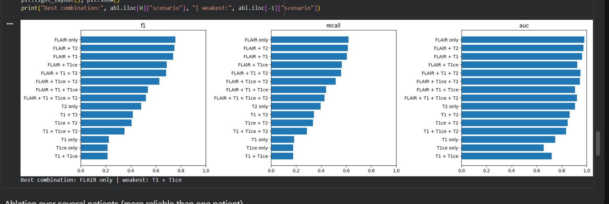 | 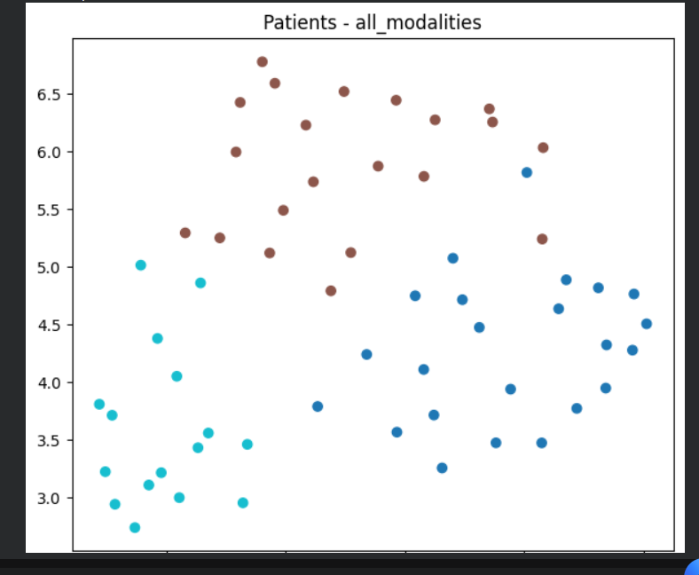 |

### Training curves
| Segmentation: training loss | Segmentation: validation Dice |
|---|---|
| 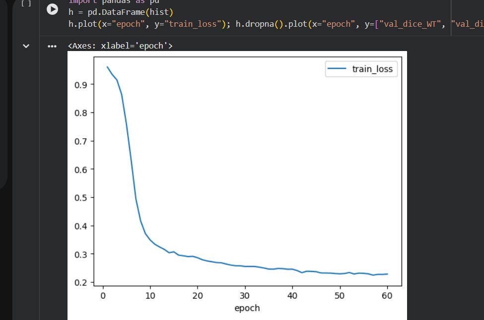 | 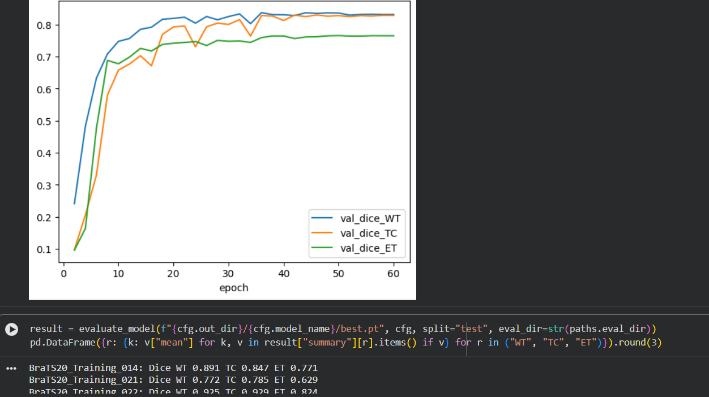 |

| Grade model: validation balanced accuracy | Grade model: loss |
|---|---|
| 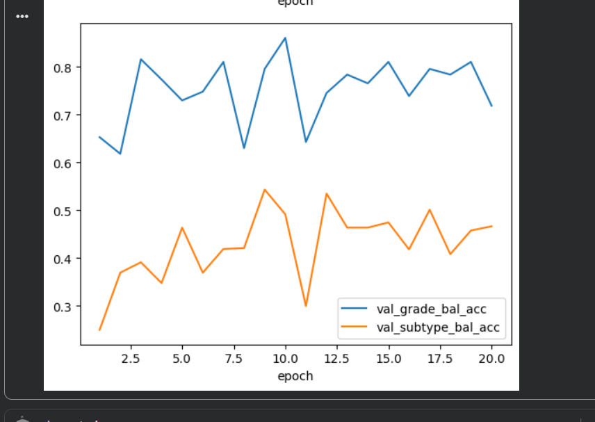 | 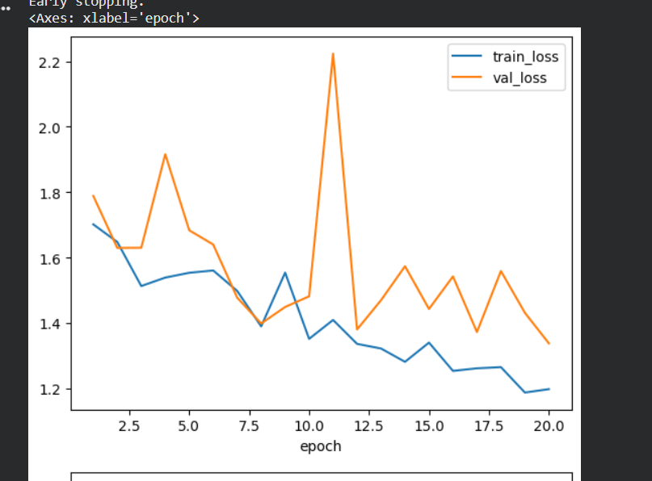 |

### Generative AI — Med-DDPM
T2 generated from noise (condition, real T2, generated T2, error, uncertainty).
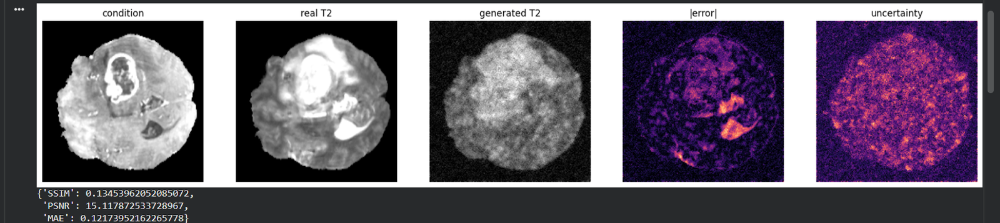

"What-if" scenarios: the model changes only the tumor area.

| After surgery (−78 %) | Tumor growth (+45 %) | Treatment response (−58 %) |
|---|---|---|
| 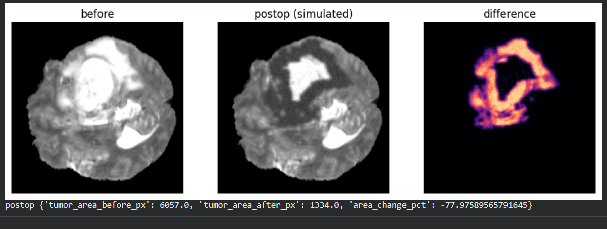 | 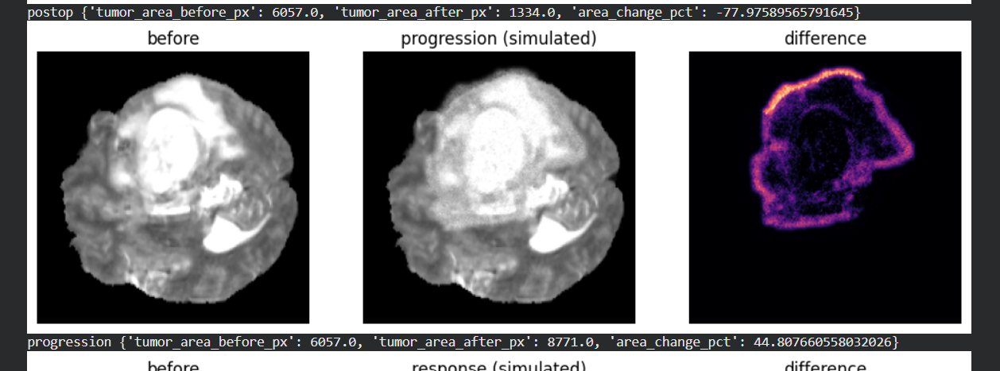 | 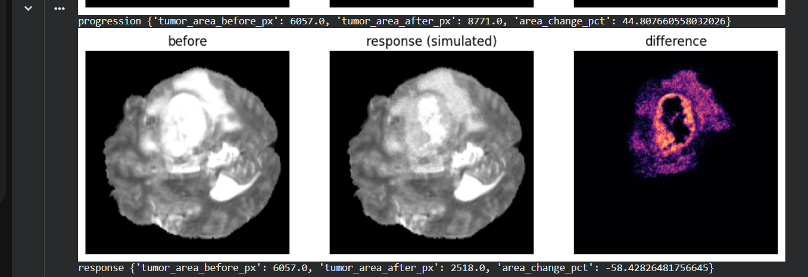 |

## Run it
The project runs in **Google Colab**, nothing to install on your computer.

| Notebook | Purpose |
|---|---|
| `00_preprocessing` | prepare the data |
| `01_data_analysis` | analyse the 4 MRI types |
| `02_classification_3d` | train the grade model |
| `03_segmentation_3d_unet` | train the segmentation model (GPU) |
| `04_medddpm_generation` | test MRI generation |
| `05_launch_app` | **launch the interface** |

1. Put the project (`BrainTumorLab.zip`) and the data in `MyDrive/miniProjetAI/` on Google Drive,
   or put this repository's address in `REPO_URL` (first cell).
2. Open a notebook in Colab and click **Runtime → Run all**.
3. For the interface: notebook `05_launch_app`, then click **Open BrainTumorLab**.

Locally: `pip install -e .` then `python -m braintumorlab.webapp.server --port 8000`.

**Technologies:** Python, PyTorch, MONAI, FastAPI, HTML/CSS/JavaScript, Chart.js, three.js, SQLite.

## Repository layout
```
src/braintumorlab/   the code (data, models, measurements, web app)
notebooks/           Colab notebooks 00 to 05
docs/screenshots/    images used in this README
tests/               automatic tests on synthetic data
```

## Limitations
- Few LGG tumors in the test set (12): grade numbers are approximate.
- Full T2 generation is not realistic yet: the model needs longer training.
- One dataset only (BraTS 2020): not yet tested on MRI from other hospitals.

## Data and license
BraTS MRI and trained models are **not** in this repository (the BraTS license does not allow sharing
them). Get the data from the official BraTS 2020 source.

References: Menze et al., IEEE TMI 2015 · Bakas et al., Scientific Data 2017 · Bakas et al., arXiv:1811.02629 · MONAI.

Author: **Safa Douma** & **Khadija Bensaad**· Code under the [MIT License](LICENSE).
